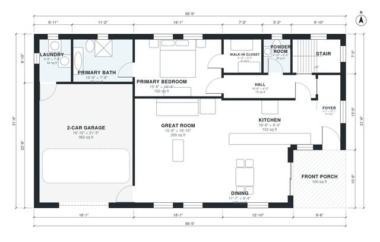

# House Plans With Loft: 3 Bed, 2.5 Bath, 2,010 Sq Ft

This two-story, 3-bedroom, 2.5-bath modern farmhouse has about 187 m² (roughly 2,010 sq ft) of living space, plus a 2-car garage and a front porch. The ground floor has an open great room, kitchen and dining area, a primary suite with bath and walk-in closet, a laundry and a powder room. Upstairs, an open loft serves two bedrooms and a bath.

| | |
|---|---|
| Levels | 2 |
| Footprint | 17.2 m × 9.6 m (56 ft × 31 ft) |
| Rooms | 17 indoor, 2 outdoor |
| Indoor area including garage, from the room grid | about 225 m² (2,421 sq ft) |

## Files here

- `area-schedule.csv` (room schedule)
- `building.json` (rooms, walls, openings as data)
- `plan-level1.dxf` (floor plan, DXF, drawing units: inches)
- `plan-level2.dxf` (floor plan, DXF, drawing units: inches)

## More for this plan

- Plan page with the PDF plan set, IFC and 3D model, and a tool to change the plan: https://floorplan.ai-architectures.com/house-plans/house-plans-with-loft?utm_source=github-plans&utm_medium=probe&utm_campaign=github
- PDF plan set: https://storage.googleapis.com/20img/house-plans/house-plans-with-loft/plan-set.pdf
- IFC model: https://storage.googleapis.com/20img/house-plans/house-plans-with-loft/model.ifc

## Known issues in this drawing

- Hall and Laundry are not directly connected.
- Laundry is 4.1 m² (asked for about 5.5 m²).
- Foyer is 4.8 m² (asked for about 7.0 m²).
- Foyer is only 1.24 m wide.

Concept design generated with AI. Not for construction or permit; verify with a licensed professional.
