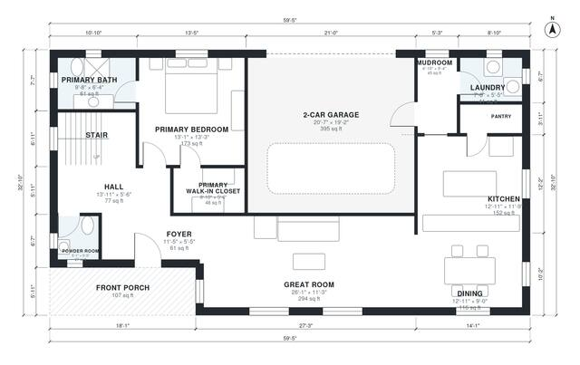

# House Plans With Master Suite on Main Floor | 2,300 Sq Ft Plan

A two-story, 3-bedroom, 2.5-bath modern farmhouse of about 204 m² (2,200 sq ft) of living space, plus a 40 m² 2-car garage. The main floor has a front porch and foyer opening to an open great room, dining and kitchen, a main-floor primary suite with a walk-in closet, a powder room and a combined mudroom and laundry off the garage. Upstairs are two bedrooms with built-in closets, a bath and a loft.

| | |
|---|---|
| Levels | 2 |
| Footprint | 18.1 m × 10.0 m (59 ft × 33 ft) |
| Rooms | 22 indoor, 2 outdoor |
| Indoor area including garage, from the room grid | about 253 m² (2,724 sq ft) |

## Files here

- `area-schedule.csv` (room schedule)
- `building.json` (rooms, walls, openings as data)
- `plan-level1.dxf` (floor plan, DXF, drawing units: inches)
- `plan-level2.dxf` (floor plan, DXF, drawing units: inches)

## More for this plan

- Plan page with the PDF plan set, IFC and 3D model, and a tool to change the plan: https://floorplan.ai-architectures.com/house-plans/house-plans-with-master-suite-on-main-floor?utm_source=github-plans&utm_medium=probe&utm_campaign=github
- PDF plan set: https://storage.googleapis.com/20img/house-plans/house-plans-with-master-suite-on-main-floor/plan-set.pdf
- IFC model: https://storage.googleapis.com/20img/house-plans/house-plans-with-master-suite-on-main-floor/model.ifc

## Known issues in this drawing

- Hall and Laundry are not directly connected.
- Foyer is 5.7 m² (asked for about 8.0 m²).
- Primary Bath is 5.7 m² (asked for about 8.0 m²).

Concept design generated with AI. Not for construction or permit; verify with a licensed professional.
