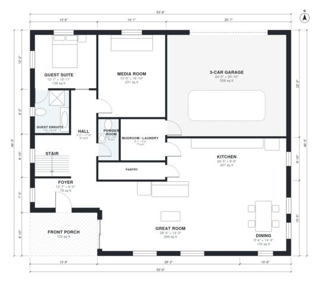

# House Plans With Media Room: 4 Bed, 3.5 Bath, 3,400 Sq Ft

A two-story modern farmhouse of about 305 m² (3,300 sq ft) of living space, plus a 3-car garage and a front porch. Downstairs has an open kitchen, dining and great room, a media room, a guest suite and a powder room. Upstairs has the primary suite with a walk-in closet, two bedrooms, a loft and a laundry. The revision widens the footprint so the garage becomes a true side-by-side 3-car garage and the kitchen and mudroom get usable widths.

| | |
|---|---|
| Levels | 2 |
| Footprint | 16.3 m × 14.1 m (53 ft × 46 ft) |
| Rooms | 23 indoor, 2 outdoor |
| Indoor area including garage, from the room grid | about 368 m² (3,966 sq ft) |

## Files here

- `area-schedule.csv` (room schedule)
- `building.json` (rooms, walls, openings as data)
- `plan-level1.dxf` (floor plan, DXF, drawing units: inches)
- `plan-level2.dxf` (floor plan, DXF, drawing units: inches)

## More for this plan

- Plan page with the PDF plan set, IFC and 3D model, and a tool to change the plan: https://floorplan.ai-architectures.com/house-plans/house-plans-with-media-room?utm_source=github-plans&utm_medium=probe&utm_campaign=github
- PDF plan set: https://storage.googleapis.com/20img/house-plans/house-plans-with-media-room/plan-set.pdf
- IFC model: https://storage.googleapis.com/20img/house-plans/house-plans-with-media-room/model.ifc

## Known issues in this drawing

- Bedroom 3 is only 2.34 m wide.

Concept design generated with AI. Not for construction or permit; verify with a licensed professional.
