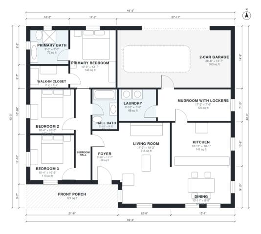

# House Plans With Mudroom: 3-Bed, 2-Bath, 1,580 Sq Ft Plan

This single-story modern farmhouse has about 172 m² (1,850 sq ft) of living space, plus a 38 m² two-car garage and a front porch. The open kitchen, dining and living area sits at the center. A large mudroom with lockers links the garage to the kitchen, and the laundry opens off the mudroom. The three bedrooms are on the west side off a bedroom hall: a primary suite with a bath and walk-in closet, and two secondary bedrooms that share a hall bath.

| | |
|---|---|
| Levels | 1 |
| Footprint | 15.0 m × 13.1 m (49 ft × 43 ft) |
| Rooms | 14 indoor, 1 outdoor |
| Indoor area including garage, from the room grid | about 185 m² (1,994 sq ft) |

## Files here

- `area-schedule.csv` (room schedule)
- `building.json` (rooms, walls, openings as data)
- `plan-level1.dxf` (floor plan, DXF, drawing units: inches)

## More for this plan

- Plan page with the PDF plan set, IFC and 3D model, and a tool to change the plan: https://floorplan.ai-architectures.com/house-plans/house-plans-with-mudroom?utm_source=github-plans&utm_medium=probe&utm_campaign=github
- PDF plan set: https://storage.googleapis.com/20img/house-plans/house-plans-with-mudroom/plan-set.pdf
- IFC model: https://storage.googleapis.com/20img/house-plans/house-plans-with-mudroom/model.ifc

## Known issues in this drawing

- Living Room is 20.1 m² (asked for about 28.0 m²).

Concept design generated with AI. Not for construction or permit; verify with a licensed professional.
