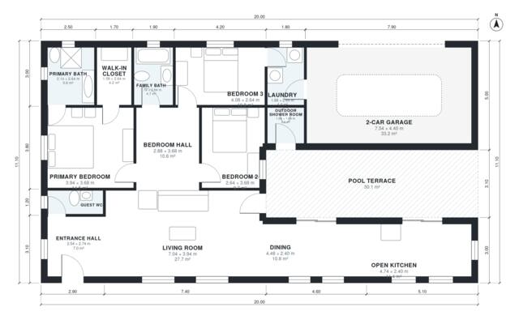

# House Plans With Pool: 3-Bed, 1,640 Sq Ft Single-Story Plan

A single-storey, 3-bedroom, 2-bath contemporary home of about 150 m² of living space (222 m² footprint including a 38 m² double garage and a 33 m² pool terrace). The open kitchen, dining and living area opens onto the pool terrace, which has its own outdoor shower room. The primary suite and two bedrooms are grouped in a separate sleeping wing. The garage connects through the laundry.

| | |
|---|---|
| Levels | 1 |
| Footprint | 20.0 m × 11.1 m (66 ft × 36 ft) |
| Rooms | 15 indoor, 1 outdoor |
| Indoor area including garage, from the room grid | about 192 m² (2,066 sq ft) |

## Files here

- `area-schedule.csv` (room schedule)
- `building.json` (rooms, walls, openings as data)
- `plan-level1.dxf` (floor plan, DXF, drawing units: millimetres)

## More for this plan

- Plan page with the PDF plan set, IFC and 3D model, and a tool to change the plan: https://floorplan.ai-architectures.com/house-plans/house-plans-with-pool?utm_source=github-plans&utm_medium=probe&utm_campaign=github
- PDF plan set: https://storage.googleapis.com/20img/house-plans/house-plans-with-pool/plan-set.pdf
- IFC model: https://storage.googleapis.com/20img/house-plans/house-plans-with-pool/model.ifc

## Known issues in this drawing

- Open Kitchen and Laundry are not directly connected.
- Dining is only 2.40 m wide.

Concept design generated with AI. Not for construction or permit; verify with a licensed professional.
