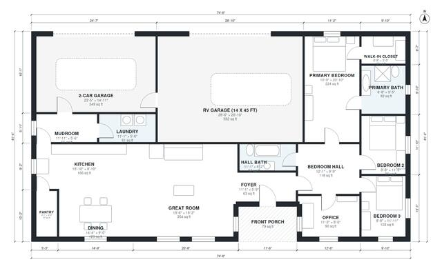

# House Plans With RV Garage: 3 Bed, 2 Bath, 1,970 Sq Ft

This single-story ranch has about 2,000 sq ft of living space. It has an open kitchen, dining and great room, a mudroom/laundry zone off the garage, and a private bedroom wing. The wing holds a primary suite with a walk-in closet, two more bedrooms, a hall bath and an office. A 2-car garage and an RV garage sit along the east side. The RV bay will need to be lengthened to 45 ft in the final design.

| | |
|---|---|
| Levels | 1 |
| Footprint | 22.7 m × 12.6 m (74 ft × 41 ft) |
| Rooms | 17 indoor, 1 outdoor |
| Indoor area including garage, from the room grid | about 279 m² (3,000 sq ft) |

## Files here

- `area-schedule.csv` (room schedule)
- `building.json` (rooms, walls, openings as data)
- `plan-level1.dxf` (floor plan, DXF, drawing units: inches)

## More for this plan

- Plan page with the PDF plan set, IFC and 3D model, and a tool to change the plan: https://floorplan.ai-architectures.com/house-plans/house-plans-with-rv-garage?utm_source=github-plans&utm_medium=probe&utm_campaign=github
- PDF plan set: https://storage.googleapis.com/20img/house-plans/house-plans-with-rv-garage/plan-set.pdf
- IFC model: https://storage.googleapis.com/20img/house-plans/house-plans-with-rv-garage/model.ifc

## Known issues in this drawing

- Foyer is 5.9 m² (asked for about 8.0 m²).

Concept design generated with AI. Not for construction or permit; verify with a licensed professional.
