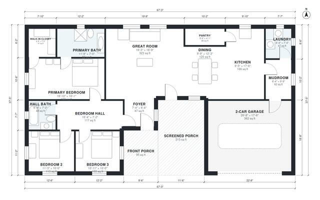

# House Plans With Screened Porch: 3 Bed, 1,780 Sq Ft Plan

This is a single-story, 3-bedroom, 2-bath home with about 165 m² (1,780 sq ft) of living space, plus a 2-car garage and covered porches. A large open great room, dining area and kitchen sit in the middle of the plan. The primary suite is at one end and two bedrooms share a hall bath at the other. The garage enters through a mudroom beside the laundry and pantry, and there are front and screened porches.

| | |
|---|---|
| Levels | 1 |
| Footprint | 20.5 m × 11.4 m (67 ft × 37 ft) |
| Rooms | 15 indoor, 2 outdoor |
| Indoor area including garage, from the room grid | about 205 m² (2,206 sq ft) |

## Files here

- `area-schedule.csv` (room schedule)
- `building.json` (rooms, walls, openings as data)
- `plan-level1.dxf` (floor plan, DXF, drawing units: inches)

## More for this plan

- Plan page with the PDF plan set, IFC and 3D model, and a tool to change the plan: https://floorplan.ai-architectures.com/house-plans/house-plans-with-screened-porch?utm_source=github-plans&utm_medium=probe&utm_campaign=github
- PDF plan set: https://storage.googleapis.com/20img/house-plans/house-plans-with-screened-porch/plan-set.pdf
- IFC model: https://storage.googleapis.com/20img/house-plans/house-plans-with-screened-porch/model.ifc

## Known issues in this drawing

- Foyer is 4.3 m² (asked for about 6.0 m²).

Concept design generated with AI. Not for construction or permit; verify with a licensed professional.
