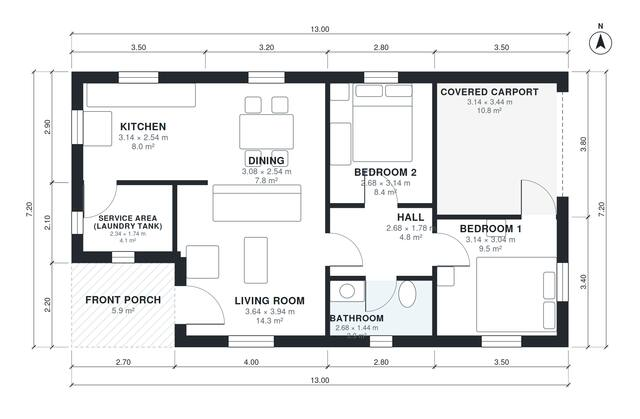

# House Plans With Service Area: 2-Bed, 800 Sq Ft Single Story

A compact single-storey house of roughly 93 m² overall, with about 74 m² of living space plus the front porch and a 1-car carport. The kitchen, dining and living areas form one open space, a covered service area with the laundry tank sits behind the kitchen, and two bedrooms and a bath open off a short hall. The revision makes sure both bedrooms open onto the hall and gives Bedroom 1 a more usable width.

| | |
|---|---|
| Levels | 1 |
| Footprint | 13.0 m × 7.2 m (43 ft × 24 ft) |
| Rooms | 9 indoor, 1 outdoor |
| Indoor area including garage, from the room grid | about 88 m² (944 sq ft) |

## Files here

- `area-schedule.csv` (room schedule)
- `building.json` (rooms, walls, openings as data)
- `plan-level1.dxf` (floor plan, DXF, drawing units: millimetres)

## More for this plan

- Plan page with the PDF plan set, IFC and 3D model, and a tool to change the plan: https://floorplan.ai-architectures.com/house-plans/house-plans-with-service-area?utm_source=github-plans&utm_medium=probe&utm_campaign=github
- PDF plan set: https://storage.googleapis.com/20img/house-plans/house-plans-with-service-area/plan-set.pdf
- IFC model: https://storage.googleapis.com/20img/house-plans/house-plans-with-service-area/model.ifc

## Known issues in this drawing

- Service Area (laundry tank) is 4.1 m² (asked for about 5.5 m²).

Concept design generated with AI. Not for construction or permit; verify with a licensed professional.
