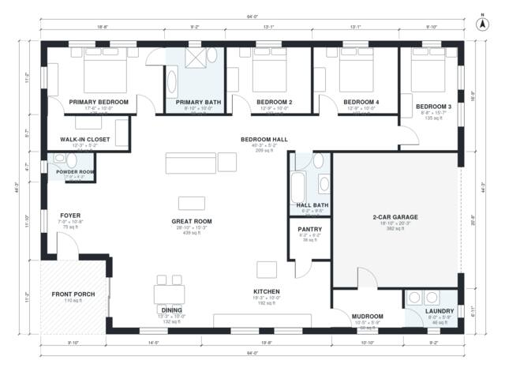

# House Plans With Side Entry Garage: 4 Bed, 2,310 Sq Ft

This is a single-story, 4-bedroom, 2.5-bath home of about 214 m² (2,300 sq ft) of living space. It measures roughly 64 by 44 ft, with the garage and porch on top of that. The open kitchen, dining and great room sit at the centre, with the bedrooms in a wing along the north side. The primary suite has its own bath and a walk-in closet. A mudroom and laundry link the kitchen to the side-entry 2-car garage, and a front porch marks the entry.

| | |
|---|---|
| Levels | 1 |
| Footprint | 19.5 m × 13.5 m (64 ft × 44 ft) |
| Rooms | 17 indoor, 1 outdoor |
| Indoor area including garage, from the room grid | about 253 m² (2,724 sq ft) |

## Files here

- `area-schedule.csv` (room schedule)
- `building.json` (rooms, walls, openings as data)
- `plan-level1.dxf` (floor plan, DXF, drawing units: inches)

## More for this plan

- Plan page with the PDF plan set, IFC and 3D model, and a tool to change the plan: https://floorplan.ai-architectures.com/house-plans/house-plans-with-side-entry-garage?utm_source=github-plans&utm_medium=probe&utm_campaign=github
- PDF plan set: https://storage.googleapis.com/20img/house-plans/house-plans-with-side-entry-garage/plan-set.pdf
- IFC model: https://storage.googleapis.com/20img/house-plans/house-plans-with-side-entry-garage/model.ifc

## Known issues in this drawing

- Great Room has no window.
- Laundry is 4.2 m² (asked for about 6.0 m²).

Concept design generated with AI. Not for construction or permit; verify with a licensed professional.
