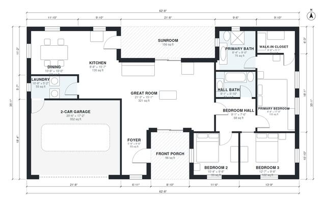

# House Plans With Sunroom: 3-Bed, 1,550 Sq Ft One-Story

This single-story ranch has about 1,900 sq ft of living space plus an attached 2-car garage. It has three bedrooms, two baths, a great room open to the kitchen and dining, and a sunroom shared by the kitchen and great room. The primary suite sits at the far end of a separate bedroom wing, the laundry doubles as the garage entry, and a covered front porch marks the entrance.

| | |
|---|---|
| Levels | 1 |
| Footprint | 19.1 m × 10.7 m (63 ft × 35 ft) |
| Rooms | 13 indoor, 2 outdoor |
| Indoor area including garage, from the room grid | about 181 m² (1,948 sq ft) |

## Files here

- `area-schedule.csv` (room schedule)
- `building.json` (rooms, walls, openings as data)
- `plan-level1.dxf` (floor plan, DXF, drawing units: inches)

## More for this plan

- Plan page with the PDF plan set, IFC and 3D model, and a tool to change the plan: https://floorplan.ai-architectures.com/house-plans/house-plans-with-sunroom?utm_source=github-plans&utm_medium=probe&utm_campaign=github
- PDF plan set: https://storage.googleapis.com/20img/house-plans/house-plans-with-sunroom/plan-set.pdf
- IFC model: https://storage.googleapis.com/20img/house-plans/house-plans-with-sunroom/model.ifc

## Known issues in this drawing

- Foyer is 5.1 m² (asked for about 7.0 m²).
- Primary Bedroom is only 2.64 m wide.

Concept design generated with AI. Not for construction or permit; verify with a licensed professional.
