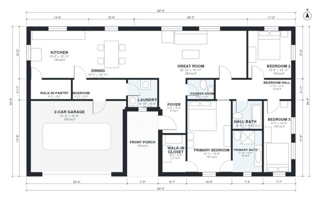

# House Plans With Walk In Pantry: 3 Bed, 1,650 Sq Ft One-Story

This is a single-story modern farmhouse of about 186 m² (2,000 sq ft) of living space. It has 3 bedrooms and 2.5 baths, plus a 38 m² attached 2-car garage and a front porch. The open kitchen with island and walk-in pantry, the dining area and the great room share one space. The garage enters through a mudroom with the laundry beside it. The primary suite is set apart from the two secondary bedrooms.

| | |
|---|---|
| Levels | 1 |
| Footprint | 19.0 m × 10.6 m (62 ft × 35 ft) |
| Rooms | 16 indoor, 1 outdoor |
| Indoor area including garage, from the room grid | about 191 m² (2,059 sq ft) |

## Files here

- `area-schedule.csv` (room schedule)
- `building.json` (rooms, walls, openings as data)
- `plan-level1.dxf` (floor plan, DXF, drawing units: inches)

## More for this plan

- Plan page with the PDF plan set, IFC and 3D model, and a tool to change the plan: https://floorplan.ai-architectures.com/house-plans/house-plans-with-walk-in-pantry?utm_source=github-plans&utm_medium=probe&utm_campaign=github
- PDF plan set: https://storage.googleapis.com/20img/house-plans/house-plans-with-walk-in-pantry/plan-set.pdf
- IFC model: https://storage.googleapis.com/20img/house-plans/house-plans-with-walk-in-pantry/model.ifc

## Known issues in this drawing

- Bedroom 3 is only 1.94 m wide.

Concept design generated with AI. Not for construction or permit; verify with a licensed professional.
