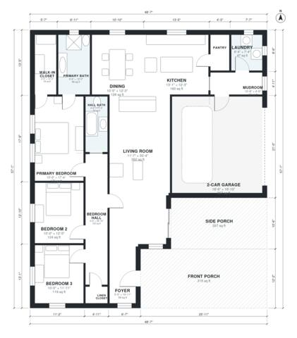

# House Plans With Wrap Around Porch: 3 Bed, 1,840 Sq Ft

This is a single-story country farmhouse of about 167 m² (1,800 sq ft) of heated space. The footprint is roughly 14.8 x 17.4 m including the garage and porches. A wrap-around porch runs along the front and one side. The foyer opens to an open kitchen, dining and living area. A separate bedroom hall serves the primary suite and two more bedrooms. A mudroom with laundry connects the kitchen to the 2-car garage.

| | |
|---|---|
| Levels | 1 |
| Footprint | 14.8 m × 17.4 m (49 ft × 57 ft) |
| Rooms | 16 indoor, 2 outdoor |
| Indoor area including garage, from the room grid | about 209 m² (2,251 sq ft) |

## Files here

- `area-schedule.csv` (room schedule)
- `building.json` (rooms, walls, openings as data)
- `plan-level1.dxf` (floor plan, DXF, drawing units: inches)

## More for this plan

- Plan page with the PDF plan set, IFC and 3D model, and a tool to change the plan: https://floorplan.ai-architectures.com/house-plans/house-plans-with-wrap-around-porch?utm_source=github-plans&utm_medium=probe&utm_campaign=github
- PDF plan set: https://storage.googleapis.com/20img/house-plans/house-plans-with-wrap-around-porch/plan-set.pdf
- IFC model: https://storage.googleapis.com/20img/house-plans/house-plans-with-wrap-around-porch/model.ifc

## Known issues in this drawing

- Side Porch is not on the street side.
- Hall Bath is only 1.38 m wide.

Concept design generated with AI. Not for construction or permit; verify with a licensed professional.
