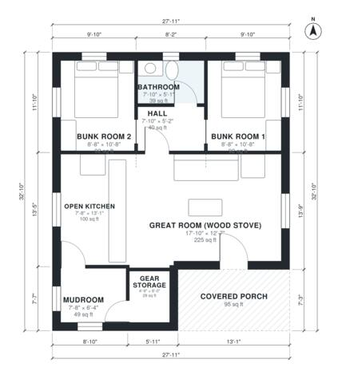

# Hunting Cabin Plans: 820 Sq Ft One-Level, 2 Bed, 1 Bath

This is a compact hunting cabin of about 75 m² (800 sq ft) indoors, plus a covered front porch. The porch opens into an open kitchen and great room built around a wood stove. Two bunk rooms and a bath sit off a short hall. A back mudroom with gear storage lets hunters come in without crossing the living space.

| | |
|---|---|
| Levels | 1 |
| Footprint | 8.5 m × 10.0 m (28 ft × 33 ft) |
| Rooms | 8 indoor, 1 outdoor |
| Indoor area including garage, from the room grid | about 76 m² (820 sq ft) |

## Files here

- `area-schedule.csv` (room schedule)
- `building.json` (rooms, walls, openings as data)
- `plan-level1.dxf` (floor plan, DXF, drawing units: inches)

## More for this plan

- Plan page with the PDF plan set, IFC and 3D model, and a tool to change the plan: https://floorplan.ai-architectures.com/house-plans/hunting-cabin-plans?utm_source=github-plans&utm_medium=probe&utm_campaign=github
- PDF plan set: https://storage.googleapis.com/20img/house-plans/hunting-cabin-plans/plan-set.pdf
- IFC model: https://storage.googleapis.com/20img/house-plans/hunting-cabin-plans/model.ifc

## Known issues in this drawing

- Gear Storage is 2.6 m² (asked for about 4.0 m²).

Concept design generated with AI. Not for construction or permit; verify with a licensed professional.
