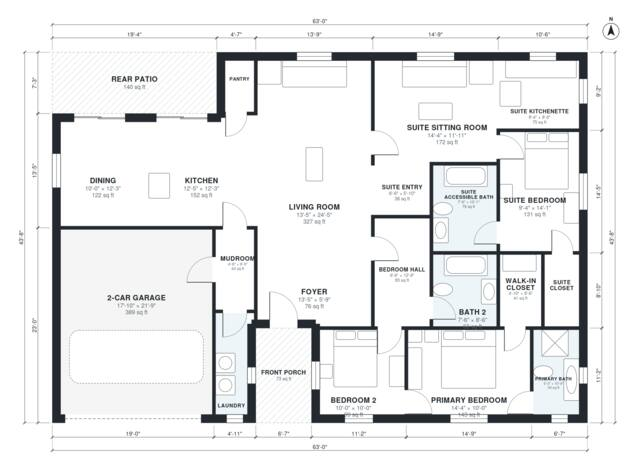

# In Law Suite Floor Plans: 2,100 Sq Ft, 3 Bed, 3 Bath Ranch

A single-story modern farmhouse with about 195 m² (2,100 sq ft) of heated space, plus a 2-car garage, front porch, rear patio and a suite stoop. The open kitchen, dining and living area opens to the rear patio. A bedroom hall serves the primary suite with walk-in closet and a second bedroom with bath. The in-law suite has its own exterior entry, sitting room, kitchenette, bedroom and a wheelchair-accessible bath. It also has a lockable door to the main house.

| | |
|---|---|
| Levels | 1 |
| Footprint | 19.2 m × 13.3 m (63 ft × 44 ft) |
| Rooms | 20 indoor, 2 outdoor |
| Indoor area including garage, from the room grid | about 236 m² (2,536 sq ft) |

## Files here

- `area-schedule.csv` (room schedule)
- `building.json` (rooms, walls, openings as data)
- `plan-level1.dxf` (floor plan, DXF, drawing units: inches)

## More for this plan

- Plan page with the PDF plan set, IFC and 3D model, and a tool to change the plan: https://floorplan.ai-architectures.com/house-plans/in-law-suite-floor-plans?utm_source=github-plans&utm_medium=probe&utm_campaign=github
- PDF plan set: https://storage.googleapis.com/20img/house-plans/in-law-suite-floor-plans/plan-set.pdf
- IFC model: https://storage.googleapis.com/20img/house-plans/in-law-suite-floor-plans/model.ifc

## Known issues in this drawing

- Bedroom Hall and Primary Bedroom are not directly connected.
- Primary Bedroom is only reachable through another bedroom.
- Laundry is only 1.14 m wide.
- Pantry is 1.9 m² (asked for about 3.0 m²).
- Primary Bath is 5.0 m² (asked for about 7.0 m²).

Concept design generated with AI. Not for construction or permit; verify with a licensed professional.
