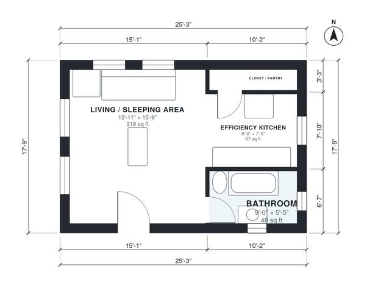

# Junior ADU Floor Plans: 450 Sq Ft Studio With Own Entry

This is a compact junior ADU of about 41.6 m² (about 448 sq ft) with its own exterior entry, an open living and sleeping room, an efficiency kitchen along one end, a private bath and a closet. The revision makes the footprint slightly deeper so the bath can reach a usable size. It also links the closet to the kitchen, matching where the closet sits in the drawing.

| | |
|---|---|
| Levels | 1 |
| Footprint | 7.7 m × 5.4 m (25 ft × 18 ft) |
| Rooms | 4 indoor, 0 outdoor |
| Indoor area including garage, from the room grid | about 42 m² (448 sq ft) |

## Files here

- `area-schedule.csv` (room schedule)
- `building.json` (rooms, walls, openings as data)
- `plan-level1.dxf` (floor plan, DXF, drawing units: inches)

## More for this plan

- Plan page with the PDF plan set, IFC and 3D model, and a tool to change the plan: https://floorplan.ai-architectures.com/house-plans/junior-adu-floor-plans?utm_source=github-plans&utm_medium=probe&utm_campaign=github
- PDF plan set: https://storage.googleapis.com/20img/house-plans/junior-adu-floor-plans/plan-set.pdf
- IFC model: https://storage.googleapis.com/20img/house-plans/junior-adu-floor-plans/model.ifc

## Known issues in this drawing

- None found by the automatic checks.

Concept design generated with AI. Not for construction or permit; verify with a licensed professional.
