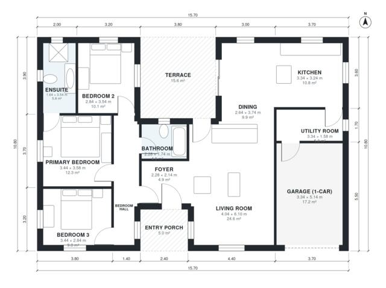

# L Shaped Bungalow Plans: 3 Bed, 2 Bath, 1,380 Sq Ft Home

A single-storey, three-bedroom, two-bath house of roughly 130 m² of living space, plus a 1-car garage and a terrace. An open kitchen, dining and living wing faces a private terrace, and the bedroom wing is reached from a short hall off the foyer. The garage enters through the utility room. The revision gives the ensuite, utility room and bedrooms better proportions.

| | |
|---|---|
| Levels | 1 |
| Footprint | 15.7 m × 10.8 m (52 ft × 35 ft) |
| Rooms | 12 indoor, 2 outdoor |
| Indoor area including garage, from the room grid | about 149 m² (1,603 sq ft) |

## Files here

- `area-schedule.csv` (room schedule)
- `building.json` (rooms, walls, openings as data)
- `plan-level1.dxf` (floor plan, DXF, drawing units: millimetres)

## More for this plan

- Plan page with the PDF plan set, IFC and 3D model, and a tool to change the plan: https://floorplan.ai-architectures.com/house-plans/l-shaped-bungalow-plans?utm_source=github-plans&utm_medium=probe&utm_campaign=github
- PDF plan set: https://storage.googleapis.com/20img/house-plans/l-shaped-bungalow-plans/plan-set.pdf
- IFC model: https://storage.googleapis.com/20img/house-plans/l-shaped-bungalow-plans/model.ifc

## Known issues in this drawing

- None found by the automatic checks.

Concept design generated with AI. Not for construction or permit; verify with a licensed professional.
