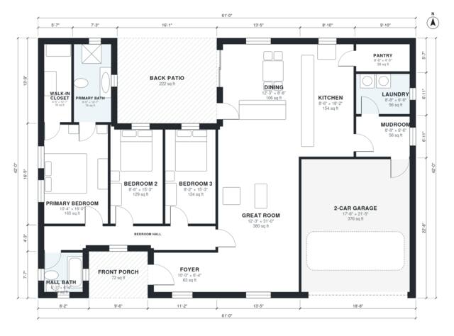

# L Shaped House Plans: 1,850 Sq Ft, 3 Bed, 2 Bath, 2-Car

A single-story ranch of about 176 m² (1,900 sq ft) of living space. The living wing has an open kitchen, dining and great room, a pantry, a laundry/mudroom and a 2-car garage. The bedroom wing has a primary suite with walk-in closet, two secondary bedrooms and a hall bath, and a back patio sits in the corner between the two wings. The revision connects the bedroom hall directly to the foyer and great room, so the bedrooms are reached from the hall and not through the primary suite.

| | |
|---|---|
| Levels | 1 |
| Footprint | 18.6 m × 12.8 m (61 ft × 42 ft) |
| Rooms | 15 indoor, 2 outdoor |
| Indoor area including garage, from the room grid | about 211 m² (2,269 sq ft) |

## Files here

- `area-schedule.csv` (room schedule)
- `building.json` (rooms, walls, openings as data)
- `plan-level1.dxf` (floor plan, DXF, drawing units: inches)

## More for this plan

- Plan page with the PDF plan set, IFC and 3D model, and a tool to change the plan: https://floorplan.ai-architectures.com/house-plans/l-shaped-house-plans?utm_source=github-plans&utm_medium=probe&utm_campaign=github
- PDF plan set: https://storage.googleapis.com/20img/house-plans/l-shaped-house-plans/plan-set.pdf
- IFC model: https://storage.googleapis.com/20img/house-plans/l-shaped-house-plans/model.ifc

## Known issues in this drawing

- Hall Bath is 3.7 m² (asked for about 6.0 m²).
- Foyer is 5.9 m² (asked for about 8.0 m²).
- Bedroom 3 is only 2.48 m wide.

Concept design generated with AI. Not for construction or permit; verify with a licensed professional.
