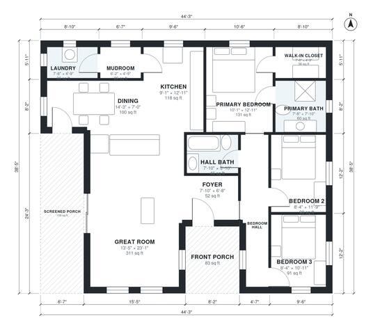

# Lake Cottage Plans: 3-Bed, 2-Bath Single-Story, 1,460 Sq Ft

This is a single-story lake cottage with about 136 m² (roughly 1,460 sq ft) of indoor living space, plus a front porch and a screened porch. A large open great room, kitchen and dining area runs along the back and opens to the screened porch. The three bedrooms are grouped along a hall, with a primary suite (bath and walk-in closet) at the rear. A mudroom and laundry sit off the kitchen.

| | |
|---|---|
| Levels | 1 |
| Footprint | 13.5 m × 11.7 m (44 ft × 38 ft) |
| Rooms | 13 indoor, 2 outdoor |
| Indoor area including garage, from the room grid | about 135 m² (1,457 sq ft) |

## Files here

- `area-schedule.csv` (room schedule)
- `building.json` (rooms, walls, openings as data)
- `plan-level1.dxf` (floor plan, DXF, drawing units: inches)

## More for this plan

- Plan page with the PDF plan set, IFC and 3D model, and a tool to change the plan: https://floorplan.ai-architectures.com/house-plans/lake-cottage-plans?utm_source=github-plans&utm_medium=probe&utm_campaign=github
- PDF plan set: https://storage.googleapis.com/20img/house-plans/lake-cottage-plans/plan-set.pdf
- IFC model: https://storage.googleapis.com/20img/house-plans/lake-cottage-plans/model.ifc

## Known issues in this drawing

- Dining is only 2.14 m wide.
- Mudroom is 2.7 m² (asked for about 5.0 m²).

Concept design generated with AI. Not for construction or permit; verify with a licensed professional.
