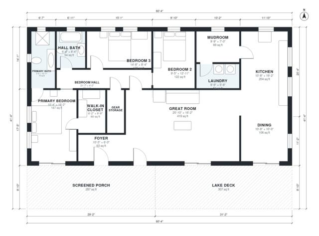

# Lake House Plans: 3-Bedroom, 1-Story, 1,900 Sq Ft Design

This one-story lake house is about 1,900 sq ft of heated space, with a 287 sq ft screened porch and a 307 sq ft deck along the lake side. A big open great room, kitchen and dining area face the water. The primary suite and two more bedrooms are grouped off a quiet hall, and a mudroom with laundry handles lake traffic.

| | |
|---|---|
| Levels | 1 |
| Footprint | 18.4 m × 12.6 m (60 ft × 41 ft) |
| Rooms | 14 indoor, 2 outdoor |
| Indoor area including garage, from the room grid | about 177 m² (1,901 sq ft) |

## Files here

- `building.json` (rooms, walls, openings as data)
- `plan-level1.dxf` (floor plan, DXF, drawing units: inches)

## More for this plan

- Plan page with the PDF plan set, IFC and 3D model, and a tool to change the plan: https://floorplan.ai-architectures.com/house-plans/lake-house-plans?utm_source=github-plans&utm_medium=probe&utm_campaign=github
- PDF plan set: https://storage.googleapis.com/20img/house-plans/lake-house-plans/plan-set.pdf
- IFC model: https://storage.googleapis.com/20img/house-plans/lake-house-plans/model.ifc

## Known issues in this drawing

- None found by the automatic checks.

Concept design generated with AI. Not for construction or permit; verify with a licensed professional.
