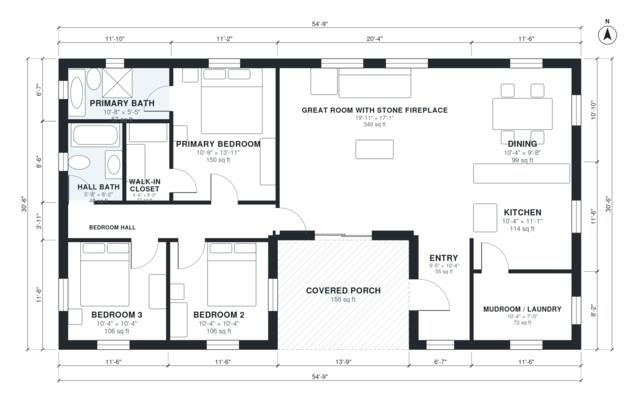

# Log Cabin Floor Plans: 1,510 Sq Ft, 3 Bed, 2 Bath Cabin

This single-storey log cabin has about 140 m² (1,500 sq ft) of living space inside a roughly 16.7 x 9.3 m footprint, plus a deep covered porch at the front. A large great room with a stone fireplace opens to the dining area and kitchen, with the mudroom and laundry beside the kitchen. Three bedrooms sit along a hall at one end of the house, including a primary suite with a bath and walk-in closet, and there is a second bath off the hall.

| | |
|---|---|
| Levels | 1 |
| Footprint | 16.7 m × 9.3 m (55 ft × 31 ft) |
| Rooms | 12 indoor, 1 outdoor |
| Indoor area including garage, from the room grid | about 141 m² (1,514 sq ft) |

## Files here

- `area-schedule.csv` (room schedule)
- `building.json` (rooms, walls, openings as data)
- `plan-level1.dxf` (floor plan, DXF, drawing units: inches)

## More for this plan

- Plan page with the PDF plan set, IFC and 3D model, and a tool to change the plan: https://floorplan.ai-architectures.com/house-plans/log-cabin-floor-plans?utm_source=github-plans&utm_medium=probe&utm_campaign=github
- PDF plan set: https://storage.googleapis.com/20img/house-plans/log-cabin-floor-plans/plan-set.pdf
- IFC model: https://storage.googleapis.com/20img/house-plans/log-cabin-floor-plans/model.ifc

## Known issues in this drawing

- None found by the automatic checks.

Concept design generated with AI. Not for construction or permit; verify with a licensed professional.
