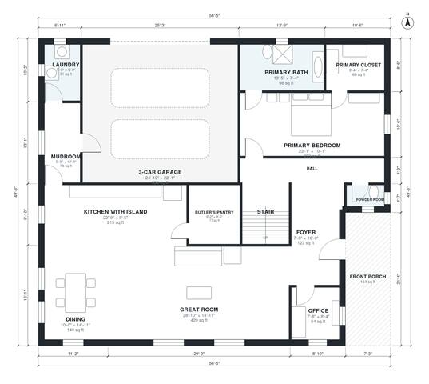

# Luxury Farmhouse Plans: 3,900 sq ft, 5 Bed, 2-Story Design

A two-story modern farmhouse of roughly 340-350 m² (about 3,700-3,800 sq ft) of living space, plus a 3-car garage and a front porch. The ground floor has a private primary suite, an open great room, kitchen and dining area, a butler's pantry, an office and a mudroom linked to the garage. Upstairs are four bedrooms, a hall bath, two bedroom baths and a bonus room over the garage.

| | |
|---|---|
| Levels | 2 |
| Footprint | 17.2 m × 15.0 m (56 ft × 49 ft) |
| Rooms | 26 indoor, 2 outdoor |
| Indoor area including garage, from the room grid | about 417 m² (4,493 sq ft) |

## Files here

- `area-schedule.csv` (room schedule)
- `building.json` (rooms, walls, openings as data)
- `plan-level1.dxf` (floor plan, DXF, drawing units: inches)
- `plan-level2.dxf` (floor plan, DXF, drawing units: inches)

## More for this plan

- Plan page with the PDF plan set, IFC and 3D model, and a tool to change the plan: https://floorplan.ai-architectures.com/house-plans/luxury-farmhouse-plans?utm_source=github-plans&utm_medium=probe&utm_campaign=github
- PDF plan set: https://storage.googleapis.com/20img/house-plans/luxury-farmhouse-plans/plan-set.pdf
- IFC model: https://storage.googleapis.com/20img/house-plans/luxury-farmhouse-plans/model.ifc

## Known issues in this drawing

- Office is 5.9 m² (asked for about 12.0 m²).
- Powder Room is 1.9 m² (asked for about 3.0 m²).

Concept design generated with AI. Not for construction or permit; verify with a licensed professional.
