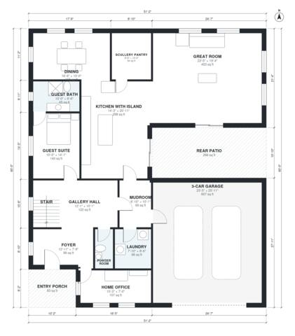

# Luxury Modern House Plans: 5 Bed, 4,030 Sq Ft Two-Story

This is a two-story contemporary home with a flat roof and about 4,350 sq ft of living space. It has an open great room, kitchen with island and scullery, dining, a home office, a ground-floor guest suite and a 3-car garage entered through the mudroom. Upstairs are the primary suite with a large walk-in closet and spa bath, three ensuite bedrooms, a family lounge, a media room over the garage and a lounge terrace. The footprint is now closer to square so the bedrooms and baths are less narrow.

| | |
|---|---|
| Levels | 2 |
| Footprint | 15.6 m × 18.3 m (51 ft × 60 ft) |
| Rooms | 27 indoor, 4 outdoor |
| Indoor area including garage, from the room grid | about 438 m² (4,716 sq ft) |

## Files here

- `area-schedule.csv` (room schedule)
- `building.json` (rooms, walls, openings as data)
- `plan-level1.dxf` (floor plan, DXF, drawing units: inches)
- `plan-level2.dxf` (floor plan, DXF, drawing units: inches)

## More for this plan

- Plan page with the PDF plan set, IFC and 3D model, and a tool to change the plan: https://floorplan.ai-architectures.com/house-plans/luxury-modern-house-plans?utm_source=github-plans&utm_medium=probe&utm_campaign=github
- PDF plan set: https://storage.googleapis.com/20img/house-plans/luxury-modern-house-plans/plan-set.pdf
- IFC model: https://storage.googleapis.com/20img/house-plans/luxury-modern-house-plans/model.ifc

## Known issues in this drawing

- Primary Walk-in Closet is 8.0 m² (asked for about 12.0 m²).

Concept design generated with AI. Not for construction or permit; verify with a licensed professional.
