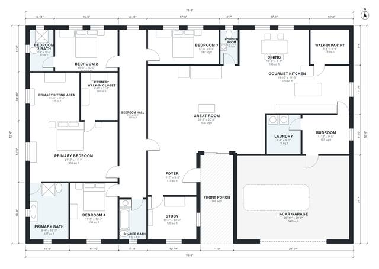

# Luxury Ranch House Plans: 4-Bed, 3,350 Sq Ft Single Story

A single-story luxury ranch of about 316 m² (3,400 sq ft) of living space, plus a 58 m² three-car garage and a 16 m² front porch. The great room, dining area and gourmet kitchen with walk-in pantry are open to each other. The primary suite has a sitting area, bath and walk-in closet, and the other three bedrooms are grouped off a separate hall. The mudroom links the garage to the kitchen and laundry, and the study sits next to the foyer.

| | |
|---|---|
| Levels | 1 |
| Footprint | 24.0 m × 16.0 m (79 ft × 52 ft) |
| Rooms | 20 indoor, 1 outdoor |
| Indoor area including garage, from the room grid | about 368 m² (3,965 sq ft) |

## Files here

- `area-schedule.csv` (room schedule)
- `building.json` (rooms, walls, openings as data)
- `plan-level1.dxf` (floor plan, DXF, drawing units: inches)

## More for this plan

- Plan page with the PDF plan set, IFC and 3D model, and a tool to change the plan: https://floorplan.ai-architectures.com/house-plans/luxury-ranch-house-plans?utm_source=github-plans&utm_medium=probe&utm_campaign=github
- PDF plan set: https://storage.googleapis.com/20img/house-plans/luxury-ranch-house-plans/plan-set.pdf
- IFC model: https://storage.googleapis.com/20img/house-plans/luxury-ranch-house-plans/model.ifc

## Known issues in this drawing

- Bedroom 3 is only 2.54 m wide.
- Dining is only 2.54 m wide.

Concept design generated with AI. Not for construction or permit; verify with a licensed professional.
