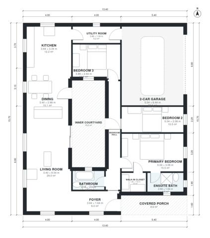

# Mediterranean House Plans One Story: 1,570 Sq Ft, 3 Bed

A single-storey Mediterranean courtyard house of about 140 m² of living space (about 1,507 sq ft), plus the garage, porch and courtyard. A covered porch and foyer lead into an open kitchen, dining and living strip, which has doors to the inner courtyard. The three bedrooms (primary with ensuite and walk-in closet) and the shared bath sit off a central hall, and the 2-car garage connects through the utility room.

| | |
|---|---|
| Levels | 1 |
| Footprint | 13.4 m × 15.7 m (44 ft × 52 ft) |
| Rooms | 13 indoor, 2 outdoor |
| Indoor area including garage, from the room grid | about 183 m² (1,965 sq ft) |

## Files here

- `area-schedule.csv` (room schedule)
- `building.json` (rooms, walls, openings as data)
- `plan-level1.dxf` (floor plan, DXF, drawing units: millimetres)

## More for this plan

- Plan page with the PDF plan set, IFC and 3D model, and a tool to change the plan: https://floorplan.ai-architectures.com/house-plans/mediterranean-house-plans-one-story?utm_source=github-plans&utm_medium=probe&utm_campaign=github
- PDF plan set: https://storage.googleapis.com/20img/house-plans/mediterranean-house-plans-one-story/plan-set.pdf
- IFC model: https://storage.googleapis.com/20img/house-plans/mediterranean-house-plans-one-story/model.ifc

## Known issues in this drawing

- Bedroom 2 is only 2.08 m wide.

Concept design generated with AI. Not for construction or permit; verify with a licensed professional.
