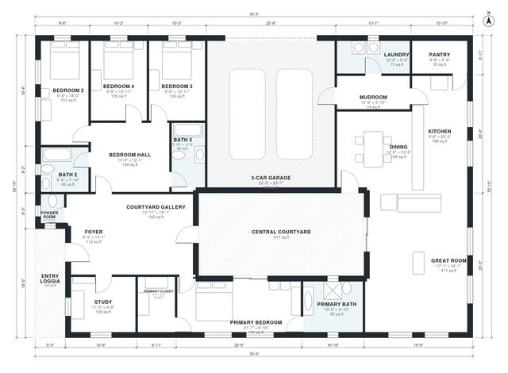

# Mediterranean House Plans: 4-Bed One-Story Courtyard Home

A single-story Mediterranean ranch of about 3,200 sq ft of living space, with a 3-car garage and an entry loggia on top of that. It wraps around a central courtyard, with a private primary suite and a separate wing for three bedrooms and two baths. The revision links the gallery directly to the great room, so the open living, dining and kitchen area is reached from the entry without crossing the courtyard.

| | |
|---|---|
| Levels | 1 |
| Footprint | 23.3 m × 16.1 m (76 ft × 53 ft) |
| Rooms | 20 indoor, 2 outdoor |
| Indoor area including garage, from the room grid | about 327 m² (3,521 sq ft) |

## Files here

- `area-schedule.csv` (room schedule)
- `building.json` (rooms, walls, openings as data)
- `plan-level1.dxf` (floor plan, DXF, drawing units: inches)

## More for this plan

- Plan page with the PDF plan set, IFC and 3D model, and a tool to change the plan: https://floorplan.ai-architectures.com/house-plans/mediterranean-house-plans?utm_source=github-plans&utm_medium=probe&utm_campaign=github
- PDF plan set: https://storage.googleapis.com/20img/house-plans/mediterranean-house-plans/plan-set.pdf
- IFC model: https://storage.googleapis.com/20img/house-plans/mediterranean-house-plans/model.ifc

## Known issues in this drawing

- Powder Room is 1.9 m² (asked for about 3.0 m²).
- Primary Bedroom is only 2.70 m wide.
- Dining has no window.

Concept design generated with AI. Not for construction or permit; verify with a licensed professional.
