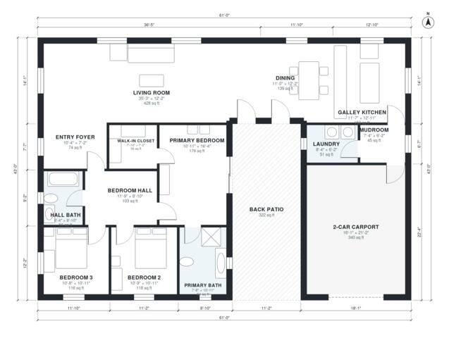

# Mid Century Modern House Plans: 3 Bed, 1,900 Sq Ft One-Story

This is a single-story mid-century modern ranch of about 1,890 sq ft (175 m²) of living space. It sits on a 61 x 43 ft footprint with a low-slope roof. A long open living, dining and galley kitchen space leads to a back patio. A separate bedroom wing holds three bedrooms, including a primary suite with a bath and walk-in closet. A mudroom and laundry connect the kitchen to the 2-car carport.

| | |
|---|---|
| Levels | 1 |
| Footprint | 18.6 m × 13.1 m (61 ft × 43 ft) |
| Rooms | 14 indoor, 1 outdoor |
| Indoor area including garage, from the room grid | about 214 m² (2,301 sq ft) |

## Files here

- `area-schedule.csv` (room schedule)
- `building.json` (rooms, walls, openings as data)
- `plan-level1.dxf` (floor plan, DXF, drawing units: inches)

## More for this plan

- Plan page with the PDF plan set, IFC and 3D model, and a tool to change the plan: https://floorplan.ai-architectures.com/house-plans/mid-century-modern-house-plans?utm_source=github-plans&utm_medium=probe&utm_campaign=github
- PDF plan set: https://storage.googleapis.com/20img/house-plans/mid-century-modern-house-plans/plan-set.pdf
- IFC model: https://storage.googleapis.com/20img/house-plans/mid-century-modern-house-plans/model.ifc

## Known issues in this drawing

- Living Room is only 3.70 m wide.

Concept design generated with AI. Not for construction or permit; verify with a licensed professional.
