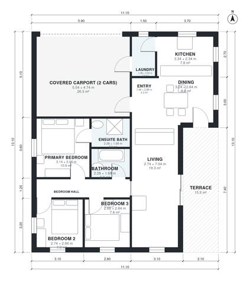

# Minimalist House Plans with Carport: 3 Bed, 1,070 Sq Ft

A single-storey flat-roof cube of about 152 m² overall. It has about 106 m² of living space, a covered 2-car carport at the front and a 16 m² rear terrace. The open kitchen, dining and living area opens to the terrace through glass. Three compact bedrooms and two baths sit off a separate bedroom hall, with the laundry beside the carport entry. The revision uses a wider, shallower footprint so the main rooms are better proportioned and the bedrooms are reached from the entry rather than through the living room.

| | |
|---|---|
| Levels | 1 |
| Footprint | 11.1 m × 13.1 m (36 ft × 43 ft) |
| Rooms | 12 indoor, 1 outdoor |
| Indoor area including garage, from the room grid | about 130 m² (1,398 sq ft) |

## Files here

- `area-schedule.csv` (room schedule)
- `building.json` (rooms, walls, openings as data)
- `plan-level1.dxf` (floor plan, DXF, drawing units: millimetres)

## More for this plan

- Plan page with the PDF plan set, IFC and 3D model, and a tool to change the plan: https://floorplan.ai-architectures.com/house-plans/minimalist-house-plans-with-carport?utm_source=github-plans&utm_medium=probe&utm_campaign=github
- PDF plan set: https://storage.googleapis.com/20img/house-plans/minimalist-house-plans-with-carport/plan-set.pdf
- IFC model: https://storage.googleapis.com/20img/house-plans/minimalist-house-plans-with-carport/model.ifc

## Known issues in this drawing

- Living is only 2.74 m wide.

Concept design generated with AI. Not for construction or permit; verify with a licensed professional.
