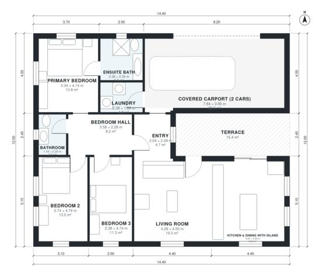

# Minimalist House Plans: 3-Bed Flat-Roof Single-Story Home

A single-storey flat-roof minimalist home of about 115 m² of living space, with a 2-car carport (about 36 m²) and a rear terrace (about 16 m²) on top of that. It has an open kitchen, dining and living area with an island and full-height glass to the terrace, and three bedrooms in a quiet wing off a hall. The primary bedroom has an ensuite, there is one shared bath, and the laundry opens off the carport.

| | |
|---|---|
| Levels | 1 |
| Footprint | 14.4 m × 12.0 m (47 ft × 39 ft) |
| Rooms | 11 indoor, 1 outdoor |
| Indoor area including garage, from the room grid | about 157 m² (1,695 sq ft) |

## Files here

- `area-schedule.csv` (room schedule)
- `building.json` (rooms, walls, openings as data)
- `plan-level1.dxf` (floor plan, DXF, drawing units: millimetres)

## More for this plan

- Plan page with the PDF plan set, IFC and 3D model, and a tool to change the plan: https://floorplan.ai-architectures.com/house-plans/minimalist-house-plans?utm_source=github-plans&utm_medium=probe&utm_campaign=github
- PDF plan set: https://storage.googleapis.com/20img/house-plans/minimalist-house-plans/plan-set.pdf
- IFC model: https://storage.googleapis.com/20img/house-plans/minimalist-house-plans/model.ifc

## Known issues in this drawing

- Bedroom 3 is only 2.38 m wide.
- Living Room is 19.3 m² (asked for about 28.0 m²).
- Bathroom is 3.5 m² (asked for about 5.0 m²).

Concept design generated with AI. Not for construction or permit; verify with a licensed professional.
