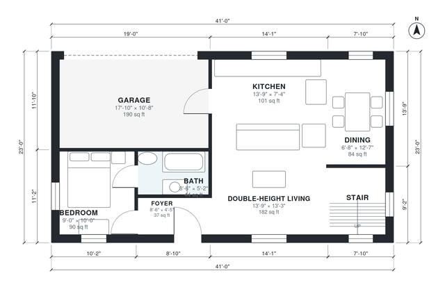

# Modern 2 Bedroom House Plans With Loft | 1,250 Sq Ft, 2 Bath

This two-story modern home has about 114 m² (roughly 1,230 sq ft) of living space, plus a 1-car garage. Downstairs, an open kitchen, dining and double-height living room sit beside a guest bedroom and bath. Upstairs are the primary suite, with its own bath and walk-in closet, and an open loft overlooking the living room.

| | |
|---|---|
| Levels | 2 |
| Footprint | 12.5 m × 7.0 m (41 ft × 23 ft) |
| Rooms | 14 indoor, 1 outdoor |
| Indoor area including garage, from the room grid | about 137 m² (1,477 sq ft) |

## Files here

- `area-schedule.csv` (room schedule)
- `building.json` (rooms, walls, openings as data)
- `plan-level1.dxf` (floor plan, DXF, drawing units: inches)
- `plan-level2.dxf` (floor plan, DXF, drawing units: inches)

## More for this plan

- Plan page with the PDF plan set, IFC and 3D model, and a tool to change the plan: https://floorplan.ai-architectures.com/house-plans/modern-2-bedroom-house-plans-with-loft?utm_source=github-plans&utm_medium=probe&utm_campaign=github
- PDF plan set: https://storage.googleapis.com/20img/house-plans/modern-2-bedroom-house-plans-with-loft/plan-set.pdf
- IFC model: https://storage.googleapis.com/20img/house-plans/modern-2-bedroom-house-plans-with-loft/model.ifc

## Known issues in this drawing

- Dining is only 2.04 m wide.
- Open Loft is 10.2 m² (asked for about 14.0 m²).
- Primary Bath is 4.2 m² (asked for about 6.0 m²).

Concept design generated with AI. Not for construction or permit; verify with a licensed professional.
