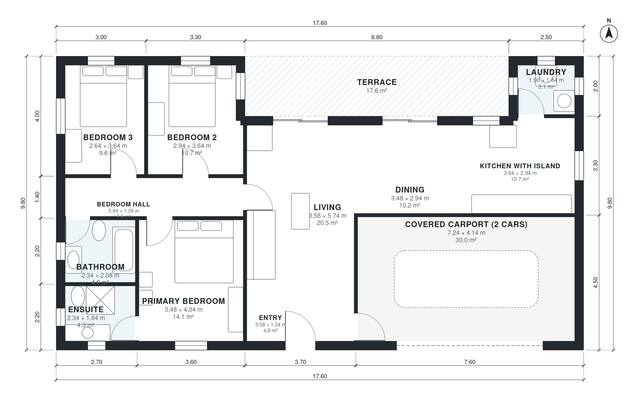

# Modern 3 Bedroom One Story House Plans: 1,300 Sq Ft Layout

A single-storey modern flat-roof house of about 125 m² of living space, with a covered 2-car carport and an 18 m² terrace outside that area. The open kitchen with island, dining and living area opens to the rear terrace through glazed doors. The three bedrooms and two baths sit in a private wing off a central hall, with an ensuite to the primary bedroom and a separate laundry off the kitchen.

| | |
|---|---|
| Levels | 1 |
| Footprint | 17.6 m × 9.8 m (58 ft × 32 ft) |
| Rooms | 12 indoor, 1 outdoor |
| Indoor area including garage, from the room grid | about 155 m² (1,667 sq ft) |

## Files here

- `area-schedule.csv` (room schedule)
- `building.json` (rooms, walls, openings as data)
- `plan-level1.dxf` (floor plan, DXF, drawing units: millimetres)

## More for this plan

- Plan page with the PDF plan set, IFC and 3D model, and a tool to change the plan: https://floorplan.ai-architectures.com/house-plans/modern-3-bedroom-one-story-house-plans?utm_source=github-plans&utm_medium=probe&utm_campaign=github
- PDF plan set: https://storage.googleapis.com/20img/house-plans/modern-3-bedroom-one-story-house-plans/plan-set.pdf
- IFC model: https://storage.googleapis.com/20img/house-plans/modern-3-bedroom-one-story-house-plans/model.ifc

## Known issues in this drawing

- Living is 20.5 m² (asked for about 30.0 m²).
- Laundry is 3.1 m² (asked for about 5.0 m²).

Concept design generated with AI. Not for construction or permit; verify with a licensed professional.
