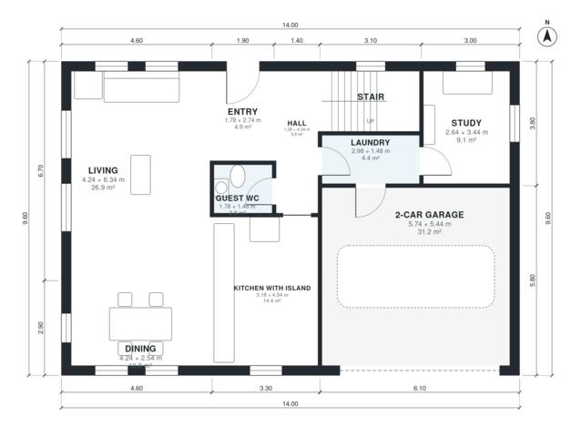

# Modern 4 Bedroom Two Story House Plans | 2,040 Sq Ft Plan

A compact two-storey flat-roof house of about 190 m² of living space with a separate 2-car garage. The ground floor has an open kitchen with island, dining and living area, plus a study, guest WC and laundry linked to the garage. Upstairs are the primary suite with dressing room, three bedrooms, a family bath and a terrace over the garage. The plan is being re-proportioned so the kitchen, living room, garage and bedrooms are wider and better shaped.

| | |
|---|---|
| Levels | 2 |
| Footprint | 14.0 m × 9.6 m (46 ft × 31 ft) |
| Rooms | 19 indoor, 1 outdoor |
| Indoor area including garage, from the room grid | about 225 m² (2,417 sq ft) |

## Files here

- `area-schedule.csv` (room schedule)
- `building.json` (rooms, walls, openings as data)
- `plan-level1.dxf` (floor plan, DXF, drawing units: millimetres)
- `plan-level2.dxf` (floor plan, DXF, drawing units: millimetres)

## More for this plan

- Plan page with the PDF plan set, IFC and 3D model, and a tool to change the plan: https://floorplan.ai-architectures.com/house-plans/modern-4-bedroom-two-story-house-plans?utm_source=github-plans&utm_medium=probe&utm_campaign=github
- PDF plan set: https://storage.googleapis.com/20img/house-plans/modern-4-bedroom-two-story-house-plans/plan-set.pdf
- IFC model: https://storage.googleapis.com/20img/house-plans/modern-4-bedroom-two-story-house-plans/model.ifc

## Known issues in this drawing

- Entry and Study are not directly connected.
- Dining is only 2.54 m wide.
- Family Bath is 5.2 m² (asked for about 7.0 m²).
- Bedroom 4 is 8.0 m² (asked for about 12.0 m²).
- Bedroom 3 is 7.0 m² (asked for about 12.0 m²).

Concept design generated with AI. Not for construction or permit; verify with a licensed professional.
