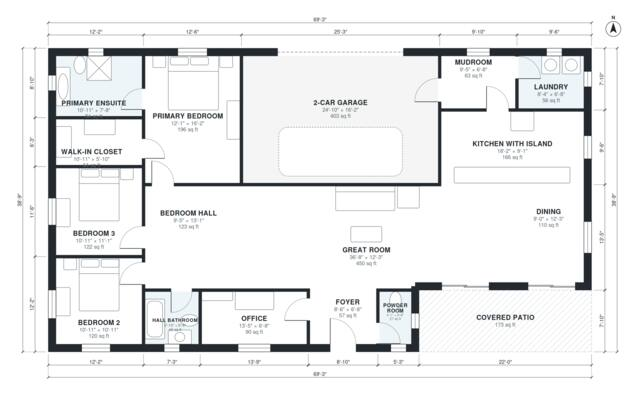

# Modern Barndominium Floor Plans: 3 Bed, 2.5 Bath, 2,070 Sq Ft

A single-story black-metal barndominium of about 193 m² (roughly 2,080 sq ft) of living space. It has a 2-car garage and a covered patio. An open great room, island kitchen and dining area sit at the center, with a private three-bedroom wing off a hall. The primary suite has an ensuite and walk-in closet, and the garage enters through a mudroom and laundry. The revision trims the great room slightly to give the kitchen, dining, powder room and primary suite more usable proportions.

| | |
|---|---|
| Levels | 1 |
| Footprint | 21.1 m × 11.8 m (69 ft × 39 ft) |
| Rooms | 16 indoor, 1 outdoor |
| Indoor area including garage, from the room grid | about 233 m² (2,507 sq ft) |

## Files here

- `area-schedule.csv` (room schedule)
- `building.json` (rooms, walls, openings as data)
- `plan-level1.dxf` (floor plan, DXF, drawing units: inches)

## More for this plan

- Plan page with the PDF plan set, IFC and 3D model, and a tool to change the plan: https://floorplan.ai-architectures.com/house-plans/modern-barndominium-floor-plans?utm_source=github-plans&utm_medium=probe&utm_campaign=github
- PDF plan set: https://storage.googleapis.com/20img/house-plans/modern-barndominium-floor-plans/plan-set.pdf
- IFC model: https://storage.googleapis.com/20img/house-plans/modern-barndominium-floor-plans/model.ifc

## Known issues in this drawing

- Great Room is only 3.74 m wide.

Concept design generated with AI. Not for construction or permit; verify with a licensed professional.
