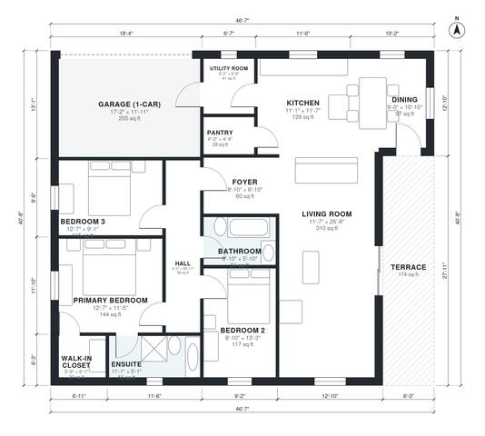

# Modern Bungalow House Plans: 3 Bed, 2 Bath, 1,480 Sq Ft

This single-story flat-roofed modern bungalow has about 137 m² (1,475 sq ft) of living space on a compact footprint of about 15.6 × 11.3 m. The open kitchen, dining and living area has large glass doors to a 16 m² rear terrace. The three bedrooms sit in a quiet wing along a hall: the primary suite has an ensuite and walk-in closet, and there is a shared bath. A 1-car garage connects to the kitchen through the utility room.

| | |
|---|---|
| Levels | 1 |
| Footprint | 14.2 m × 12.4 m (47 ft × 41 ft) |
| Rooms | 14 indoor, 1 outdoor |
| Indoor area including garage, from the room grid | about 160 m² (1,721 sq ft) |

## Files here

- `area-schedule.csv` (room schedule)
- `building.json` (rooms, walls, openings as data)
- `plan-level1.dxf` (floor plan, DXF, drawing units: inches)

## More for this plan

- Plan page with the PDF plan set, IFC and 3D model, and a tool to change the plan: https://floorplan.ai-architectures.com/house-plans/modern-bungalow-house-plans?utm_source=github-plans&utm_medium=probe&utm_campaign=github
- PDF plan set: https://storage.googleapis.com/20img/house-plans/modern-bungalow-house-plans/plan-set.pdf
- IFC model: https://storage.googleapis.com/20img/house-plans/modern-bungalow-house-plans/model.ifc

## Known issues in this drawing

- Walk-in Closet is 2.7 m² (asked for about 4.0 m²).

Concept design generated with AI. Not for construction or permit; verify with a licensed professional.
