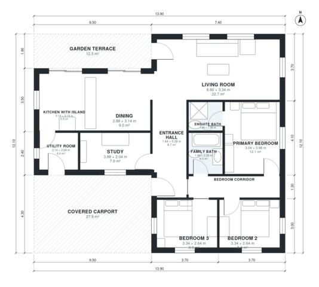

# Modern Bungalow With Flat Roof: 3 Bed, 2 Bath, 1,380 Sq Ft

A single-storey, flat-roofed garden house of about 125 m² of living space (1,346 sq ft), plus a covered two-car carport at the front and a garden terrace. It has three bedrooms, two baths, a study and a utility room. The open kitchen with island, dining and living area faces the garden through large glazing. The bedrooms are grouped off a private corridor, and the primary bedroom has its own ensuite.

| | |
|---|---|
| Levels | 1 |
| Footprint | 13.9 m × 12.1 m (46 ft × 40 ft) |
| Rooms | 12 indoor, 2 outdoor |
| Indoor area including garage, from the room grid | about 128 m² (1,377 sq ft) |

## Files here

- `area-schedule.csv` (room schedule)
- `building.json` (rooms, walls, openings as data)
- `plan-level1.dxf` (floor plan, DXF, drawing units: millimetres)

## More for this plan

- Plan page with the PDF plan set, IFC and 3D model, and a tool to change the plan: https://floorplan.ai-architectures.com/house-plans/modern-bungalow-with-flat-roof?utm_source=github-plans&utm_medium=probe&utm_campaign=github
- PDF plan set: https://storage.googleapis.com/20img/house-plans/modern-bungalow-with-flat-roof/plan-set.pdf
- IFC model: https://storage.googleapis.com/20img/house-plans/modern-bungalow-with-flat-roof/model.ifc

## Known issues in this drawing

- Ensuite Bath is 3.0 m² (asked for about 4.5 m²).

Concept design generated with AI. Not for construction or permit; verify with a licensed professional.
