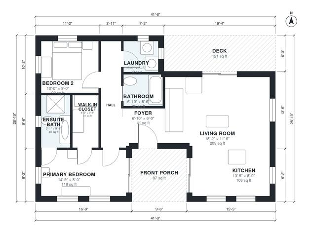

# Modern Cabin Plans: 990 Sq Ft, 2 Bed, 2 Bath Single Story

This is a single-story modern cabin of about 100 m² (roughly 1,075 sq ft) of indoor space, plus a front porch and a rear deck. A large open kitchen and living room with big windows opens onto the deck. A short hall leads to the primary suite (ensuite and walk-in closet), a second bedroom, a full bath and the laundry.

| | |
|---|---|
| Levels | 1 |
| Footprint | 12.7 m × 8.8 m (42 ft × 29 ft) |
| Rooms | 10 indoor, 2 outdoor |
| Indoor area including garage, from the room grid | about 92 m² (995 sq ft) |

## Files here

- `area-schedule.csv` (room schedule)
- `building.json` (rooms, walls, openings as data)
- `plan-level1.dxf` (floor plan, DXF, drawing units: inches)

## More for this plan

- Plan page with the PDF plan set, IFC and 3D model, and a tool to change the plan: https://floorplan.ai-architectures.com/house-plans/modern-cabin-plans?utm_source=github-plans&utm_medium=probe&utm_campaign=github
- PDF plan set: https://storage.googleapis.com/20img/house-plans/modern-cabin-plans/plan-set.pdf
- IFC model: https://storage.googleapis.com/20img/house-plans/modern-cabin-plans/model.ifc

## Known issues in this drawing

- Primary Bedroom is only 2.44 m wide.
- Living Room is only 3.50 m wide.

Concept design generated with AI. Not for construction or permit; verify with a licensed professional.
