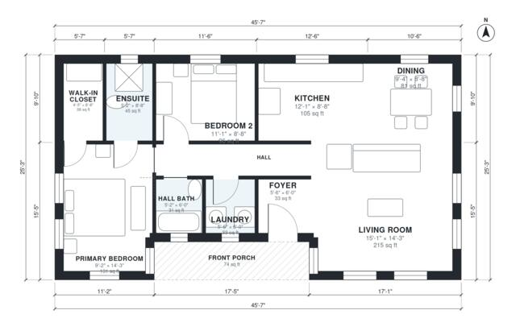

# Modern Cottage House Plans: 1,080 Sq Ft, 2 Bed, 2 Bath

This single-story modern cottage has about 100 m² (roughly 1,075 sq ft) of enclosed living space plus a 7 m² front porch. An open kitchen, dining and living area sits at the front and south side. A central hall leads to a primary suite with ensuite and walk-in closet, a second bedroom, a hall bath and a laundry. The kitchen and dining are on the compact side, and we can rebalance them if you prefer.

| | |
|---|---|
| Levels | 1 |
| Footprint | 13.9 m × 7.7 m (46 ft × 25 ft) |
| Rooms | 11 indoor, 1 outdoor |
| Indoor area including garage, from the room grid | about 100 m² (1,078 sq ft) |

## Files here

- `area-schedule.csv` (room schedule)
- `building.json` (rooms, walls, openings as data)
- `plan-level1.dxf` (floor plan, DXF, drawing units: inches)

## More for this plan

- Plan page with the PDF plan set, IFC and 3D model, and a tool to change the plan: https://floorplan.ai-architectures.com/house-plans/modern-cottage-house-plans?utm_source=github-plans&utm_medium=probe&utm_campaign=github
- PDF plan set: https://storage.googleapis.com/20img/house-plans/modern-cottage-house-plans/plan-set.pdf
- IFC model: https://storage.googleapis.com/20img/house-plans/modern-cottage-house-plans/model.ifc

## Known issues in this drawing

- Primary Bedroom is only 2.80 m wide.
- Hall Bath is 2.9 m² (asked for about 4.5 m²).
- Ensuite is 4.2 m² (asked for about 6.0 m²).

Concept design generated with AI. Not for construction or permit; verify with a licensed professional.
