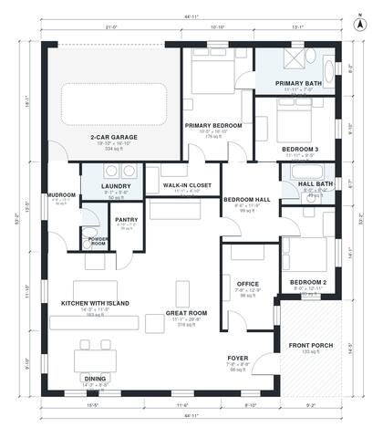

# Modern Craftsman House Plans: 1,880 Sq Ft, 3 Bed Ranch

This single-story craftsman plan has about 2,000 sq ft (185 m²) of living space plus a 2-car garage and a covered front porch. It has an open kitchen with island, great room and dining area, an office, a mudroom off the garage, and a private primary suite. Two more bedrooms and a hall bath sit in a separate wing. The revision uses a more compact footprint so the kitchen and bedrooms are better proportioned and the porch sits at the front entry.

| | |
|---|---|
| Levels | 1 |
| Footprint | 13.7 m × 16.2 m (45 ft × 53 ft) |
| Rooms | 17 indoor, 1 outdoor |
| Indoor area including garage, from the room grid | about 210 m² (2,256 sq ft) |

## Files here

- `area-schedule.csv` (room schedule)
- `building.json` (rooms, walls, openings as data)
- `plan-level1.dxf` (floor plan, DXF, drawing units: inches)

## More for this plan

- Plan page with the PDF plan set, IFC and 3D model, and a tool to change the plan: https://floorplan.ai-architectures.com/house-plans/modern-craftsman-house-plans?utm_source=github-plans&utm_medium=probe&utm_campaign=github
- PDF plan set: https://storage.googleapis.com/20img/house-plans/modern-craftsman-house-plans/plan-set.pdf
- IFC model: https://storage.googleapis.com/20img/house-plans/modern-craftsman-house-plans/model.ifc

## Known issues in this drawing

- Bedroom 2 is only 2.44 m wide.

Concept design generated with AI. Not for construction or permit; verify with a licensed professional.
