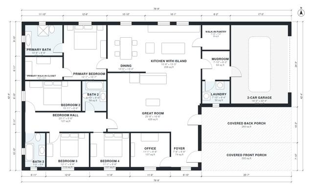

# Modern Farmhouse Plans: 4-Bed One-Story, 2,370 Sq Ft Home

This single-story modern farmhouse has about 2,700 sq ft of heated space, with 4 bedrooms and 3 baths. It has a vaulted great room open to a large island kitchen with a walk-in pantry. It also has an office by the entry, a mudroom and laundry off the 2-car garage, and covered front and back porches. The revision connects the primary suite to the bedroom hall, with its door to the hall. It also gives the dining area more room.

| | |
|---|---|
| Levels | 1 |
| Footprint | 23.4 m × 12.9 m (77 ft × 42 ft) |
| Rooms | 18 indoor, 2 outdoor |
| Indoor area including garage, from the room grid | about 259 m² (2,787 sq ft) |

## Files here

- `area-schedule.csv` (room schedule)
- `building.json` (rooms, walls, openings as data)
- `plan-level1.dxf` (floor plan, DXF, drawing units: inches)

## More for this plan

- Plan page with the PDF plan set, IFC and 3D model, and a tool to change the plan: https://floorplan.ai-architectures.com/house-plans/modern-farmhouse-plans?utm_source=github-plans&utm_medium=probe&utm_campaign=github
- PDF plan set: https://storage.googleapis.com/20img/house-plans/modern-farmhouse-plans/plan-set.pdf
- IFC model: https://storage.googleapis.com/20img/house-plans/modern-farmhouse-plans/model.ifc

## Known issues in this drawing

- Great Room and Primary Bedroom are not directly connected.
- Great Room has no window.
- 2-Car Garage is only 4.94 m wide.

Concept design generated with AI. Not for construction or permit; verify with a licensed professional.
