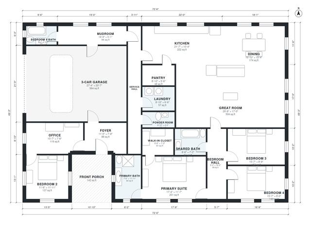

# Modern House Plans With 3 Car Garage: 4 Bed, 2,830 Sq Ft

A single-story modern home of about 331 m² including the garage and porch, with roughly 2,850 sq ft of living space. The open kitchen, dining and Great Room face the glass wall. The 3-car garage enters through the mudroom and service hall. The primary suite and three bedrooms sit off their own hall, reached from the Great Room without passing through any bedroom.

| | |
|---|---|
| Levels | 1 |
| Footprint | 22.1 m × 15.0 m (73 ft × 49 ft) |
| Rooms | 20 indoor, 1 outdoor |
| Indoor area including garage, from the room grid | about 318 m² (3,426 sq ft) |

## Files here

- `area-schedule.csv` (room schedule)
- `building.json` (rooms, walls, openings as data)
- `plan-level1.dxf` (floor plan, DXF, drawing units: inches)

## More for this plan

- Plan page with the PDF plan set, IFC and 3D model, and a tool to change the plan: https://floorplan.ai-architectures.com/house-plans/modern-house-plans-with-3-car-garage?utm_source=github-plans&utm_medium=probe&utm_campaign=github
- PDF plan set: https://storage.googleapis.com/20img/house-plans/modern-house-plans-with-3-car-garage/plan-set.pdf
- IFC model: https://storage.googleapis.com/20img/house-plans/modern-house-plans-with-3-car-garage/model.ifc

## Known issues in this drawing

- Bedroom Hall and Bedroom 2 are not directly connected.
- Bedroom 4 and Bedroom 4 Bath are not directly connected.

Concept design generated with AI. Not for construction or permit; verify with a licensed professional.
