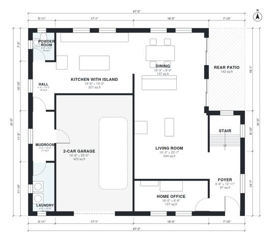

# Modern House Plans: 4-Bed, 2-Story, 2,610 Sq Ft Design

A two-story flat-roofed modern home of about 250 m² (roughly 2,700 sq ft) of living space plus a 2-car garage and rear patio. Downstairs has an open kitchen with island, dining and living area, a home office, powder room, laundry and a mudroom connecting to the garage. Upstairs has the primary suite with walk-in closet and ensuite, three bedrooms, a hall bath and a small loft landing.

| | |
|---|---|
| Levels | 2 |
| Footprint | 14.4 m × 12.5 m (47 ft × 41 ft) |
| Rooms | 22 indoor, 2 outdoor |
| Indoor area including garage, from the room grid | about 285 m² (3,066 sq ft) |

## Files here

- `area-schedule.csv` (room schedule)
- `building.json` (rooms, walls, openings as data)
- `plan-level1.dxf` (floor plan, DXF, drawing units: inches)
- `plan-level2.dxf` (floor plan, DXF, drawing units: inches)

## More for this plan

- Plan page with the PDF plan set, IFC and 3D model, and a tool to change the plan: https://floorplan.ai-architectures.com/house-plans/modern-house-plans?utm_source=github-plans&utm_medium=probe&utm_campaign=github
- PDF plan set: https://storage.googleapis.com/20img/house-plans/modern-house-plans/plan-set.pdf
- IFC model: https://storage.googleapis.com/20img/house-plans/modern-house-plans/model.ifc

## Known issues in this drawing

- 2-Car Garage is only 5.08 m wide.
- Bedroom 2 is only 2.34 m wide.
- Loft is only 2.34 m wide.

Concept design generated with AI. Not for construction or permit; verify with a licensed professional.
