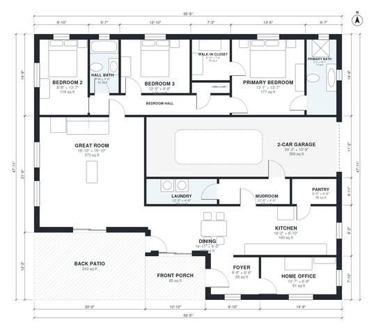

# Modern Ranch House Plans: 1,930 Sq Ft, 3 Bed, 2 Bath Home

This is a single-story modern ranch of about 1,900 sq ft of living space (plus the garage, porch and patio). A large open kitchen, dining and great room runs along a wall of glass to the back patio. The three bedrooms sit in a quiet wing, with the primary suite at the end. The home office is just off the foyer, and the 2-car garage connects through a mudroom and laundry to the kitchen.

| | |
|---|---|
| Levels | 1 |
| Footprint | 16.9 m × 14.6 m (55 ft × 48 ft) |
| Rooms | 17 indoor, 2 outdoor |
| Indoor area including garage, from the room grid | about 216 m² (2,328 sq ft) |

## Files here

- `area-schedule.csv` (room schedule)
- `building.json` (rooms, walls, openings as data)
- `plan-level1.dxf` (floor plan, DXF, drawing units: inches)

## More for this plan

- Plan page with the PDF plan set, IFC and 3D model, and a tool to change the plan: https://floorplan.ai-architectures.com/house-plans/modern-ranch-house-plans?utm_source=github-plans&utm_medium=probe&utm_campaign=github
- PDF plan set: https://storage.googleapis.com/20img/house-plans/modern-ranch-house-plans/plan-set.pdf
- IFC model: https://storage.googleapis.com/20img/house-plans/modern-ranch-house-plans/model.ifc

## Known issues in this drawing

- Dining is only 2.44 m wide.

Concept design generated with AI. Not for construction or permit; verify with a licensed professional.
