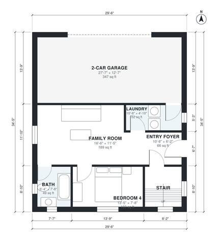

# Modern Split Level House Plans: 4 Bed, 3.5 Bath, 2,390 Sq Ft

This is a flat-roofed modern split-level home of about 2,350 sq ft of living space plus a 2-car garage. The garage, laundry, family room and 4th bedroom sit on the entry level. The open kitchen, dining and living area on the main level has large glazing and a deck. The upper level has the primary suite with a walk-in closet and roof terrace, plus two bedrooms and a hall bath.

| | |
|---|---|
| Levels | 3 |
| Footprint | 9.0 m × 10.5 m (30 ft × 34 ft) |
| Rooms | 21 indoor, 2 outdoor |
| Indoor area including garage, from the room grid | about 260 m² (2,794 sq ft) |

## Files here

- `area-schedule.csv` (room schedule)
- `building.json` (rooms, walls, openings as data)
- `plan-level1.dxf` (floor plan, DXF, drawing units: inches)
- `plan-level2.dxf` (floor plan, DXF, drawing units: inches)
- `plan-level3.dxf` (floor plan, DXF, drawing units: inches)

## More for this plan

- Plan page with the PDF plan set, IFC and 3D model, and a tool to change the plan: https://floorplan.ai-architectures.com/house-plans/modern-split-level-house-plans?utm_source=github-plans&utm_medium=probe&utm_campaign=github
- PDF plan set: https://storage.googleapis.com/20img/house-plans/modern-split-level-house-plans/plan-set.pdf
- IFC model: https://storage.googleapis.com/20img/house-plans/modern-split-level-house-plans/model.ifc

## Known issues in this drawing

- Bedroom 4 is only 2.34 m wide.
- Bedroom 3 is only 2.14 m wide.

Concept design generated with AI. Not for construction or permit; verify with a licensed professional.
