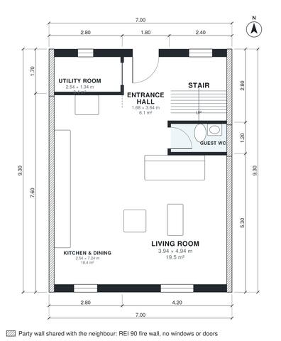

# Modern Townhouse Plans: 3-Bed, 2.5-Bath, 1,400 Sq Ft Plan

A 7 x 9.3 m mid-terrace townhouse of about 130 m² on two levels with a flat roof. The ground floor has an open kitchen with island, dining and living, with glazing to the garden, plus a guest WC and utility room in the middle. Upstairs has three bedrooms, a family bath and a primary ensuite, all lit from the front or rear. The revision gives Bedroom 3 a usable width and proportion. Built against the neighbours on the left and right (party walls, fire wall without windows or doors); the rooms take their daylight from the free sides.

| | |
|---|---|
| Levels | 2 |
| Footprint | 7.0 m × 9.3 m (23 ft × 31 ft) |
| Rooms | 13 indoor, 0 outdoor |
| Indoor area including garage, from the room grid | about 130 m² (1,401 sq ft) |

## Files here

- `area-schedule.csv` (room schedule)
- `building.json` (rooms, walls, openings as data)
- `plan-level1.dxf` (floor plan, DXF, drawing units: millimetres)
- `plan-level2.dxf` (floor plan, DXF, drawing units: millimetres)

## More for this plan

- Plan page with the PDF plan set, IFC and 3D model, and a tool to change the plan: https://floorplan.ai-architectures.com/house-plans/modern-townhouse-plans?utm_source=github-plans&utm_medium=probe&utm_campaign=github
- PDF plan set: https://storage.googleapis.com/20img/house-plans/modern-townhouse-plans/plan-set.pdf
- IFC model: https://storage.googleapis.com/20img/house-plans/modern-townhouse-plans/model.ifc

## Known issues in this drawing

- Bedroom 3 is only 2.14 m wide.

Concept design generated with AI. Not for construction or permit; verify with a licensed professional.
