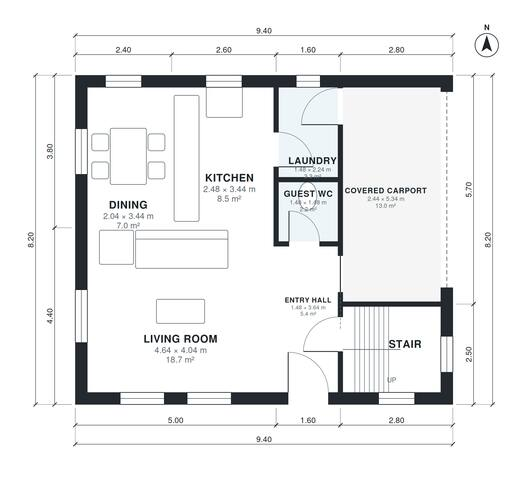

# Modern Two Storey House Plans 120 m2: 3 Bed, 1,320 Sq Ft

A compact two-storey flat-roofed house of about 121 m² of living space, with a covered one-car carport at the front that is not counted in that area. The ground floor has an open kitchen, dining and living area, a guest WC and a laundry. Upstairs are three bedrooms, a bathroom and a balcony off the main bedroom.

| | |
|---|---|
| Levels | 2 |
| Footprint | 9.4 m × 8.2 m (31 ft × 27 ft) |
| Rooms | 14 indoor, 1 outdoor |
| Indoor area including garage, from the room grid | about 139 m² (1,497 sq ft) |

## Files here

- `area-schedule.csv` (room schedule)
- `building.json` (rooms, walls, openings as data)
- `plan-level1.dxf` (floor plan, DXF, drawing units: millimetres)
- `plan-level2.dxf` (floor plan, DXF, drawing units: millimetres)

## More for this plan

- Plan page with the PDF plan set, IFC and 3D model, and a tool to change the plan: https://floorplan.ai-architectures.com/house-plans/modern-two-storey-house-plans-120-m2?utm_source=github-plans&utm_medium=probe&utm_campaign=github
- PDF plan set: https://storage.googleapis.com/20img/house-plans/modern-two-storey-house-plans-120-m2/plan-set.pdf
- IFC model: https://storage.googleapis.com/20img/house-plans/modern-two-storey-house-plans-120-m2/model.ifc

## Known issues in this drawing

- Dining is only 2.04 m wide.
- Covered Carport is only 2.44 m wide.

Concept design generated with AI. Not for construction or permit; verify with a licensed professional.
