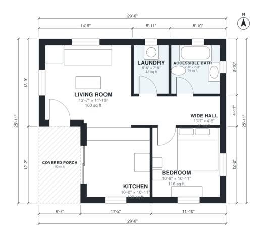

# Mother In Law Cottage Plans: 1 Bed, 690 Sq Ft Accessible

This is a step-free, one-bedroom cottage of about 71 m² (roughly 765 sq ft including the covered porch), with about 63 m² (680 sq ft) of indoor space. It has an open kitchen and living area, a covered entry porch, an accessible bath with a roll-in shower, and a laundry room. The revision widens the hall and gives the bedroom a direct hall door so it no longer opens off the bath. It also sizes the laundry so a stacked or side-by-side washer and dryer fit.

| | |
|---|---|
| Levels | 1 |
| Footprint | 9.0 m × 7.9 m (30 ft × 26 ft) |
| Rooms | 6 indoor, 1 outdoor |
| Indoor area including garage, from the room grid | about 64 m² (686 sq ft) |

## Files here

- `area-schedule.csv` (room schedule)
- `building.json` (rooms, walls, openings as data)
- `plan-level1.dxf` (floor plan, DXF, drawing units: inches)

## More for this plan

- Plan page with the PDF plan set, IFC and 3D model, and a tool to change the plan: https://floorplan.ai-architectures.com/house-plans/mother-in-law-cottage-plans?utm_source=github-plans&utm_medium=probe&utm_campaign=github
- PDF plan set: https://storage.googleapis.com/20img/house-plans/mother-in-law-cottage-plans/plan-set.pdf
- IFC model: https://storage.googleapis.com/20img/house-plans/mother-in-law-cottage-plans/model.ifc

## Known issues in this drawing

- None found by the automatic checks.

Concept design generated with AI. Not for construction or permit; verify with a licensed professional.
