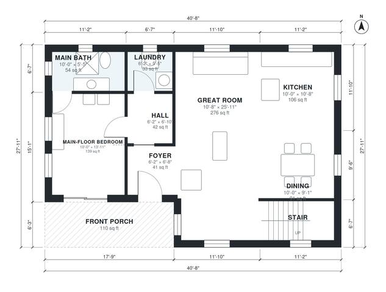

# Mountain Cabin Plans: 3-Bed, 2-Bath Story-and-a-Half Home

This is a compact story-and-a-half mountain cabin of about 1,600 sq ft of living space, plus a covered front porch. The main floor has an open great room, kitchen and dining area. It also has a private main-floor bedroom with a bath and a laundry, all reached from the foyer and hall. Upstairs, a loft opens to two bedrooms and a shared bath under the gable roof.

| | |
|---|---|
| Levels | 2 |
| Footprint | 12.4 m × 8.5 m (41 ft × 28 ft) |
| Rooms | 14 indoor, 2 outdoor |
| Indoor area including garage, from the room grid | about 149 m² (1,600 sq ft) |

## Files here

- `area-schedule.csv` (room schedule)
- `building.json` (rooms, walls, openings as data)
- `plan-level1.dxf` (floor plan, DXF, drawing units: inches)
- `plan-level2.dxf` (floor plan, DXF, drawing units: inches)

## More for this plan

- Plan page with the PDF plan set, IFC and 3D model, and a tool to change the plan: https://floorplan.ai-architectures.com/house-plans/mountain-cabin-plans?utm_source=github-plans&utm_medium=probe&utm_campaign=github
- PDF plan set: https://storage.googleapis.com/20img/house-plans/mountain-cabin-plans/plan-set.pdf
- IFC model: https://storage.googleapis.com/20img/house-plans/mountain-cabin-plans/model.ifc

## Known issues in this drawing

- None found by the automatic checks.

Concept design generated with AI. Not for construction or permit; verify with a licensed professional.
