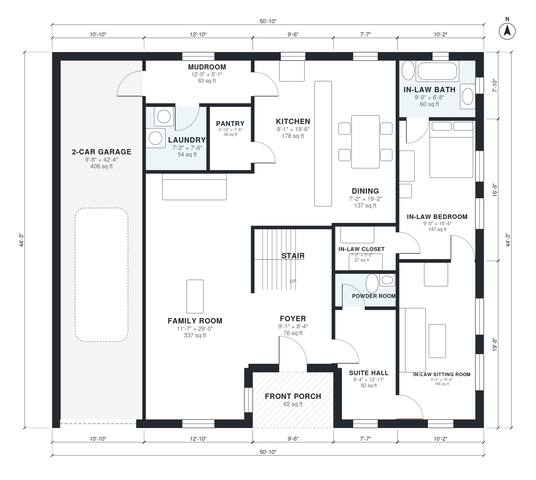

# Multigenerational House Plans: 4-Bed Two-Story In-Law Suite

This two-storey modern farmhouse has about 3,090 sq ft of living space, plus a 2-car garage and a front porch. The ground floor has an open kitchen, dining and family room, a mudroom with laundry beside the garage, and a private in-law suite with a sitting room, bedroom, bath and walk-in closet on its own hall. Upstairs are the primary suite with bath and walk-in closet, two more bedrooms, a hall bath, a loft and a study.

| | |
|---|---|
| Levels | 2 |
| Footprint | 15.5 m × 13.5 m (51 ft × 44 ft) |
| Rooms | 25 indoor, 2 outdoor |
| Indoor area including garage, from the room grid | about 340 m² (3,658 sq ft) |

## Files here

- `area-schedule.csv` (room schedule)
- `building.json` (rooms, walls, openings as data)
- `plan-level1.dxf` (floor plan, DXF, drawing units: inches)
- `plan-level2.dxf` (floor plan, DXF, drawing units: inches)

## More for this plan

- Plan page with the PDF plan set, IFC and 3D model, and a tool to change the plan: https://floorplan.ai-architectures.com/house-plans/multigenerational-house-plans?utm_source=github-plans&utm_medium=probe&utm_campaign=github
- PDF plan set: https://storage.googleapis.com/20img/house-plans/multigenerational-house-plans/plan-set.pdf
- IFC model: https://storage.googleapis.com/20img/house-plans/multigenerational-house-plans/model.ifc

## Known issues in this drawing

- Dining is only 2.18 m wide.
- In-Law Sitting Room is only 2.74 m wide.

Concept design generated with AI. Not for construction or permit; verify with a licensed professional.
