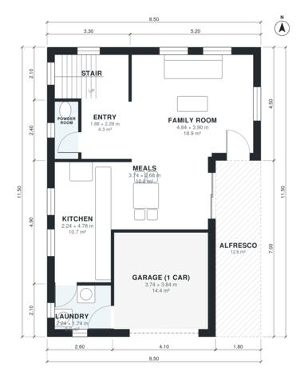

# Narrow Block House Plans: 3 Bed, 2.5 Bath, 1,780 Sq Ft

A compact two-storey home on an 8.5 x 11.5 m footprint, suited to a 10 m block, with about 160-165 m² of living space plus a 1-car garage and alfresco. The ground floor has an open kitchen, meals and family room that flow to a covered alfresco, with a powder room and laundry beside the garage. Upstairs are the master suite with ensuite and walk-in robe, two bedrooms, a family bathroom and a study nook.

| | |
|---|---|
| Levels | 2 |
| Footprint | 8.5 m × 11.5 m (28 ft × 38 ft) |
| Rooms | 17 indoor, 1 outdoor |
| Indoor area including garage, from the room grid | about 183 m² (1,969 sq ft) |

## Files here

- `area-schedule.csv` (room schedule)
- `building.json` (rooms, walls, openings as data)
- `plan-level1.dxf` (floor plan, DXF, drawing units: millimetres)
- `plan-level2.dxf` (floor plan, DXF, drawing units: millimetres)

## More for this plan

- Plan page with the PDF plan set, IFC and 3D model, and a tool to change the plan: https://floorplan.ai-architectures.com/house-plans/narrow-block-house-plans?utm_source=github-plans&utm_medium=probe&utm_campaign=github
- PDF plan set: https://storage.googleapis.com/20img/house-plans/narrow-block-house-plans/plan-set.pdf
- IFC model: https://storage.googleapis.com/20img/house-plans/narrow-block-house-plans/model.ifc

## Known issues in this drawing

- Garage (1 car) is 14.4 m² (asked for about 20.0 m²).
- Powder Room is 2.1 m² (asked for about 3.0 m²).
- Powder Room is only 0.94 m wide.

Concept design generated with AI. Not for construction or permit; verify with a licensed professional.
