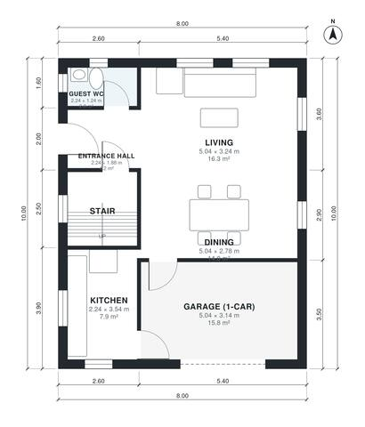

# Narrow House Plans with Garage 8 m Wide | 3 Bed, 2.5 Bath

A compact 8 x 10 m two-storey house with about 140 m² of living space and an attached 1-car garage at the front. The ground floor has an open kitchen, dining and living area, a guest WC and a central stair. Upstairs there are three bedrooms, a family bathroom and a primary ensuite with a walk-in closet. The revision removes the narrow laundry slot so the guest WC and dining room get more usable proportions. The garage will open straight into the kitchen. Laundry can be a washer/dryer in the garage or a cupboard.

| | |
|---|---|
| Levels | 2 |
| Footprint | 8.0 m × 10.0 m (26 ft × 33 ft) |
| Rooms | 15 indoor, 0 outdoor |
| Indoor area including garage, from the room grid | about 160 m² (1,722 sq ft) |

## Files here

- `area-schedule.csv` (room schedule)
- `building.json` (rooms, walls, openings as data)
- `plan-level1.dxf` (floor plan, DXF, drawing units: millimetres)
- `plan-level2.dxf` (floor plan, DXF, drawing units: millimetres)

## More for this plan

- Plan page with the PDF plan set, IFC and 3D model, and a tool to change the plan: https://floorplan.ai-architectures.com/house-plans/narrow-house-plans-with-garage-8-m-wide?utm_source=github-plans&utm_medium=probe&utm_campaign=github
- PDF plan set: https://storage.googleapis.com/20img/house-plans/narrow-house-plans-with-garage-8-m-wide/plan-set.pdf
- IFC model: https://storage.googleapis.com/20img/house-plans/narrow-house-plans-with-garage-8-m-wide/model.ifc

## Known issues in this drawing

- Dining is only 2.78 m wide.
- Kitchen is 7.9 m² (asked for about 14.0 m²).
- Entrance Hall is 4.2 m² (asked for about 6.0 m²).
- Walk-in Closet is only 1.58 m wide.

Concept design generated with AI. Not for construction or permit; verify with a licensed professional.
