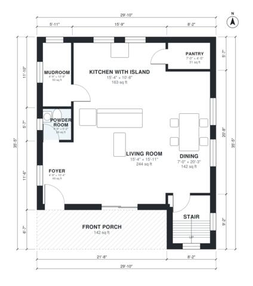

# Narrow Lot Farmhouse Plans: 3 Bed, 2.5 Bath, 1,830 Sq Ft

This is a two-story modern farmhouse, 29'-10" wide, with about 1,800 sq ft of conditioned space plus a covered front porch. The ground floor is an open kitchen with island, dining and living area, with a mudroom, pantry, powder room and stair at the back. Upstairs, a central hall serves a primary suite with walk-in closet, two more bedrooms, a hall bath and a laundry, and Bedroom 2 opens onto a balcony over the porch roof.

| | |
|---|---|
| Levels | 2 |
| Footprint | 9.1 m × 10.8 m (30 ft × 35 ft) |
| Rooms | 17 indoor, 2 outdoor |
| Indoor area including garage, from the room grid | about 170 m² (1,832 sq ft) |

## Files here

- `area-schedule.csv` (room schedule)
- `building.json` (rooms, walls, openings as data)
- `plan-level1.dxf` (floor plan, DXF, drawing units: inches)
- `plan-level2.dxf` (floor plan, DXF, drawing units: inches)

## More for this plan

- Plan page with the PDF plan set, IFC and 3D model, and a tool to change the plan: https://floorplan.ai-architectures.com/house-plans/narrow-lot-farmhouse-plans?utm_source=github-plans&utm_medium=probe&utm_campaign=github
- PDF plan set: https://storage.googleapis.com/20img/house-plans/narrow-lot-farmhouse-plans/plan-set.pdf
- IFC model: https://storage.googleapis.com/20img/house-plans/narrow-lot-farmhouse-plans/model.ifc

## Known issues in this drawing

- Dining is only 2.14 m wide.
- Pantry is 2.9 m² (asked for about 4.0 m²).
- Walk-in Closet is 3.5 m² (asked for about 5.0 m²).

Concept design generated with AI. Not for construction or permit; verify with a licensed professional.
